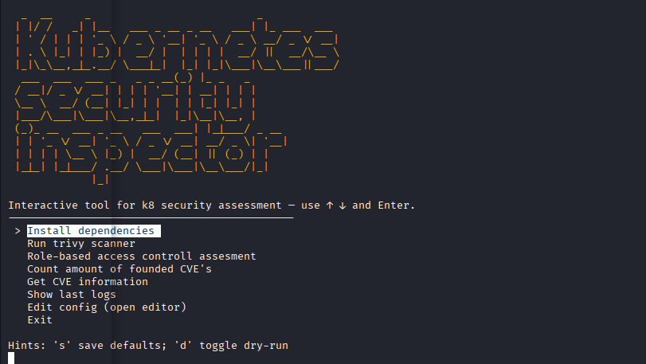

# Kubernetes security inspector  :lock: [](https://awesome.re)
Interactive CLI tool for Kubernetes security assessment.
## Introduction




Project consists of two main parts:
1. Python scripts for gathering information about Kubernetes cluster and its components.
2. Script that triggers trivy and scan vulnerabilities.
3. Python scripts that count number of vulnerabilities, group them by severity and 
give additional info about them.

#### Required tools
* Python 3.*
* bash
* kubectl
* [Trivy](https://github.com/aquasecurity/trivy)
* [CVEmap](https://github.com/projectdiscovery/cvemap)


## Installation and usage
* clone repository with ```git clone https://github.com/TheUnknownSoul/k8s-security```
* run ```chmod +x k8_inspector.sh```
* run ```./k8_inspector.sh```
* using arrows select what you want to do
* follow instructions and hints in the terminal


### Version 0.0.1
- Check Role - base access control
- Count same type vulnerabilities 
- Give info about CVE's

### Planned features
- Check Pod Security Policies
- Check Network Policies
- Check Ingresses
- Check ConfigMaps
- Check Service Accounts
- Check Nodes
- Check Deployments
- Check StatefulSets
- Check DaemonSets
- Check Jobs
- Check CronJobs
- Check Services
- Check Volumes
- Check Helm releases